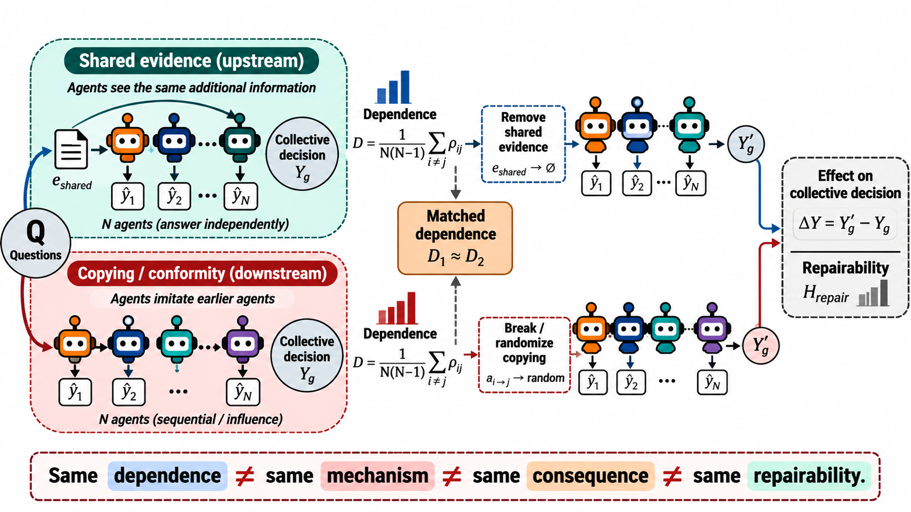

# Dependence Is Not Enough in Multi-Agent LLM Reasoning

> **Same dependence ≠ same mechanism ≠ same consequence ≠ same repairability.**

When a crowd of LLM agents agrees, that agreement can come from two very different
places: the agents all saw the **same evidence**, or they **copied each other**. Classical
theory (Condorcet juries, correlated-error analysis) only measures *how much* agents'
errors are correlated. This project asks the question that measurement alone can't
answer: **does it matter *why* they're correlated** — and can that distinction be
measured, and controlled, in real LLM populations?

---

## The core idea

We replace the usual `(competence, correlation)` description of a collective with a
richer state that keeps track of *where the correlation came from*:

```
S = (p, D, M, N)
    p : single-agent competence
    D : dependence STRENGTH        (how correlated are agent errors)
    M : dependence MECHANISM       ∈ { shared evidence (upstream), social copying (downstream) }
    N : population size
```

The central claim is that collective accuracy does **not** factor through `(p, D, N)`
alone — `M` is load-bearing. Two populations with *identical* measured dependence `D`
can land on opposite collective outcomes depending on whether that dependence came from
upstream shared evidence or downstream copying.

To test this causally, we built a **matched-dependence instrument**: hold evidence
quality fixed, vary only the causal mechanism, and compare collectives whose *measured*
`D` is equalized (`D₁ ≈ D₂`) but whose *mechanism* differs.

<p align="center">
  
</p>

<p align="center"><em>
The same measured dependence <code>D</code> is produced two causally distinct ways — agents
shown shared evidence (upstream) vs. agents copying each other (downstream) — then each arm is
perturbed (remove the shared evidence / break the copying) to read off the effect on the
collective decision (<code>ΔY</code>) and how much of it is repairable (<code>H_repair</code>).
</em></p>

This is the engine behind the project's chain of results:

```
   M ──────► D ──[χ]──► ΔY ──[directionality]──► H_repair

   M : causal mechanism generating dependence   (shared evidence vs. social copying)
   D : measured error dependence                (replicate-level, identifiable)
   χ : collective decision susceptibility       (low-margin / boundary gating)
   ΔY: collective decision change                P(Y_corr ≠ Y_indep)
   H_repair: recoverable accuracy from decorrelation alone
```

- **Stage I — `D ⇏ M`**: dependence magnitude alone does not reveal its mechanism.
- **Stage II — `D ⇏ ΔY`**: a change in dependence only moves the collective decision
  through the susceptibility gate `χ` (concentrated near low-margin states).
- **Stage III — `ΔY ⇏ H_repair`**: even a changed decision is only *repairable* in its
  net directional sense — a diagnosed dependence is not automatically an actionable one.

## Headline results

Experiments were run across **3 open-weight model families** (Qwen, Llama, Gemma) and
**3 benchmarks** (TruthfulQA, StrategyQA, AQuA), at matched dependence levels, in an
easy/hard difficulty split.

- **Mechanism non-equivalence (C1).** At matched `D`, shared-evidence and copying
  populations produce systematically different collective decision behavior across all
  three model families (caliper-matched gap ≈ 0.12, nested mechanism coefficient | D =
  0.114, both directions consistent across 9/9 model×benchmark pairs).
- **Dependence magnitude is directionally identifiable (C3).** Across 66 recovered
  strata, 63/66 move in the predicted direction (p = 0.0005).
- **Accuracy is regime-invariant (TOST gate).** The mean accuracy gap between
  mechanisms is statistically equivalent to zero (|E[ΔA]| < 0.05) in both easy and hard
  regimes — the mechanism shapes *how* decisions change, not raw accuracy.
- **Diagnosis ≠ actionability (repair-headroom bound, Theorem 6).** For
  independence-restoring interventions, recoverable accuracy is exactly bounded by the
  net directional flip `p₊₋ − p₋₊`. On near-consensus benchmarks this headroom is
  effectively zero even when the measured dependence is high — decorrelation alone is
  not a universal fix.

Full theory (theorems + proofs) lives in [`theory/`](theory/); the manuscript write-up
is [`paper.md`](paper.md).

## Repository layout

```
src/mfg_llm/           core library — opinion-state dynamics, mean-field estimation,
                        LLM-agent debate harness, control/intervention operators
experiments/           one directory per experiment (matrix estimation, propagation
                        of chaos, phase transition, optimal control, LLM-native runs)
theory/                formal setup, linearized dynamics, MFG limit, HJB-FPK
                        equilibrium, theorems 1-6 with proofs
results/                figures, tables, and logs backing every number in the paper
figures/                publication-ready plots (PNG + PDF)
scripts/                figure-generation and analysis scripts
tests/                  pytest suite
run/                    experiment launch scripts
paper.md                manuscript (current source of truth for results & narrative)
doc.md                  original theory blueprint (mean-field game formalism)
```

## Getting started

```bash
# conda (recommended — pulls torch/pytest via conda-forge)
conda env create -f environment.yml
conda activate mfg-llm-debate

# or pip
pip install -e .
pip install -r requirements.txt
```

Run the test suite:

```bash
pytest
```

Explore an experiment (e.g. the phase-transition sweep):

```bash
ls experiments/
python -m experiments.exp3_phase_transition.run --help
```

Figures backing the paper are regenerated from `results/tables/` via the scripts in
[`scripts/figures`](scripts/figures).

## Status

The experimental campaign (breadth sweep + matched-dependence Tier-3 causal instrument)
is **closed**. Current work is manuscript writing and theory consolidation — see
`paper.md` for the latest numbers and narrative.


