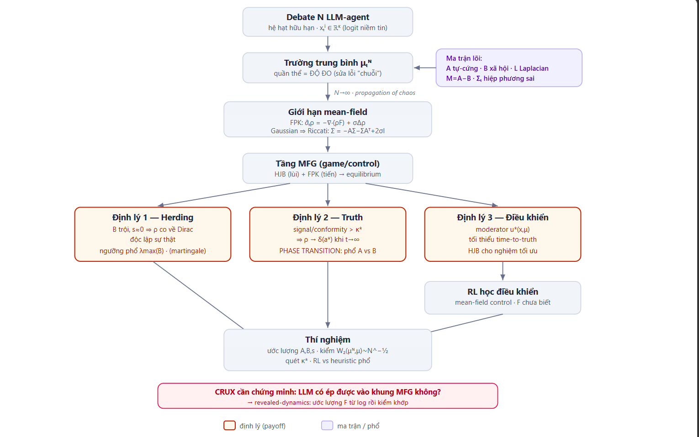

# Blueprint: Mean-Field Game Theory of Truth-Seeking LLM Debate

**Tựa tạm:** *When Does the Crowd Find the Truth? A Mean-Field Game Theory of Large-Scale LLM Deliberation*

**Một câu pitch:** Đưa lý thuyết mean-field game (HJB–Fokker-Planck, equilibrium, giới hạn N→∞) — *đúng nghĩa toán, không phải ẩn dụ* — vào một quần thể lớn LLM-agent debate, để trả lời: **khi nào đám N→∞ agent hội tụ về đáp án đúng thay vì herding, và cơ chế điều khiển tối ưu nào đảm bảo điều đó.** Nối trực tiếp kết quả martingale/Condorcet jury (N nhỏ) sang chế độ N lớn.

---

## 1. Bối cảnh & khoảng trống

- MAS-LLM debate/voting hiện chỉ chạy N ≈ 3–5 agent; lý thuyết truth-seeking (martingale, jury theorem) cũng chỉ ở N nhỏ.
- MFG cho opinion dynamics đã chín ở phi-LLM (HJB-FP, equilibrium — Bauso 2016, voting MFG 2024), nhưng: (a) chưa áp cho LLM-agent, (b) mục tiêu là *consensus/cluster xã hội*, **không phải hội tụ về sự thật**.
- MF-LLM (2025) dùng "mean-field" như *ẩn dụ* (population signal = chuỗi văn bản), **không có PDE, equilibrium, hay định lý N→∞**.

**Gap ta lấp:** khung MFG *chặt* + mục tiêu *truth-seeking* + chế độ *N→∞* cho LLM debate. Đóng góp là **bridge** (không phát minh MFG), cộng **phase transition herding↔truth** đặc trưng bằng phổ ma trận.

---

## 2. Thiết lập hình thức

### 2.1 Trạng thái ý kiến (opinion state)
Không gian đáp án hữu hạn $\mathcal{A}=\{1,\dots,K\}$. Mỗi agent $i$ ở vòng $t$ mang **logit-state** $x_t^i \in \mathbb{R}^K$, niềm tin $p_t^i = \mathrm{softmax}(x_t^i) \in \Delta^{K-1}$. (Ước lượng thực nghiệm từ log-prob của LLM trên các đáp án.)

### 2.2 Trường trung bình (mean field) — *là độ đo, không phải chuỗi*
$$\mu_t^N = \frac{1}{N}\sum_{i=1}^N \delta_{x_t^i} \in \mathcal{P}(\mathbb{R}^K).$$
Đây là chỗ sửa lỗi "lỏng" của MF-LLM: population signal = **phân phối xác suất** trên không gian ý kiến.

### 2.3 Động lực tương tác (interacting particle system)
Luật cập nhật một agent (dạng McKean–Vlasov rời rạc):
$$x_{t+1}^i = x_t^i + \eta\,F(x_t^i,\mu_t^N;\,q) + \sqrt{2\sigma}\,\xi_t^i,\qquad \xi_t^i \sim \mathcal{N}(0,I).$$
- $F$ = **drift best-response** (agent xét lại niềm tin theo bản thân + quần thể + câu hỏi $q$).
- $\sigma$ = nhiệt độ (độ ngẫu nhiên sampling của LLM).
Giới hạn liên tục → SDE McKean–Vlasov: $dx_t = F(x_t,\mu_t;q)\,dt + \sqrt{2\sigma}\,dW_t$.

### 2.4 Dạng tuyến-tính-hóa & HỆ MA TRẬN (lõi toán bạn cần)
Xấp xỉ affine của drift quanh điểm làm việc:
$$F(x,\mu;q) = -\,A\,x \;+\; B\,\bar\mu \;+\; s(q),\qquad \bar\mu=\int y\,d\mu(y).$$
- $A \in \mathbb{R}^{K\times K}$ — **ma trận tự-cứng (self-stiffness):** agent giữ chính kiến mạnh cỡ nào.
- $B \in \mathbb{R}^{K\times K}$ — **ma trận ảnh hưởng xã hội (social-influence):** quần thể kéo agent mạnh cỡ nào.
- $s(q) \in \mathbb{R}^K$ — **drift tín hiệu riêng (private evidence)** về sự thật $a^\star$ (điểm phá đối xứng, mấu chốt cho truth-seeking).

**Toán tử đồng thuận:** $M := A - B$. Trên đồ thị giao tiếp hữu hạn với kề $W$ (row-stochastic), phần tương tác thành $-\eta L x$ với **Laplacian** $L=D-W$; **spectral gap** $\lambda_2(L)$ điều khiển tốc độ trộn.

> **Ba ma trận trung tâm quyết định số phận hệ:** $A$ (tự-cứng), $B$ (xã hội), $L$ (cấu trúc). Phổ của $M=A-B$ và của $L$ phân định herding ↔ hội tụ.

---

## 3. Giới hạn mean-field (N→∞): propagation of chaos + Fokker-Planck

**Propagation of chaos:** khi $N\to\infty$, $\mu_t^N \to \mu_t$ (dòng tất định) và các agent trở nên độc lập, cùng luật $\mu_t=\mathrm{Law}(x_t)$. Mật độ $\rho_t$ của $\mu_t$ tiến hóa theo **Fokker-Planck-Kolmogorov (FPK):**
$$\partial_t \rho_t(x) = -\nabla\!\cdot\!\big(\rho_t(x)\,F(x,\mu_t;q)\big) + \sigma\,\Delta \rho_t(x).$$

**Ansatz Gaussian → hệ ODE ma trận đóng (rất đẹp để chứng minh):** nếu drift affine và $\rho_0$ Gaussian, FPK bảo toàn Gaussian $\rho_t=\mathcal{N}(m_t,\Sigma_t)$ với
$$\dot m_t = -A\,m_t + B\,m_t + s(q) = -(A-B)\,m_t + s(q),$$
$$\boxed{\;\dot\Sigma_t = -A\,\Sigma_t - \Sigma_t A^\top + 2\sigma I\;}\quad\text{(phương trình kiểu Lyapunov/Riccati cho hiệp phương sai).}$$
- **Đa dạng ý kiến** = $\mathrm{tr}\,\Sigma_t$ hoặc $\det\Sigma_t$ hoặc $\mathrm{rank}\,\Sigma_t$.
- **Sụp đồng thuận (consensus collapse)** = $\Sigma_t \to 0$. Xảy ra khi $A \succ 0$ đủ mạnh so với khuếch tán $\sigma$.
- Đây là **cầu nối trực tiếp với rank/spectral**: hội tụ điểm cố định $m_\infty=(A-B)^{-1}s(q)$ tồn tại & ổn định iff mọi trị riêng của $M=A-B$ có phần thực dương.

---

## 4. Tầng game/control: HJB–FPK equilibrium

Mỗi agent tối thiểu hóa phiếm hàm chi phí (đây là **crux cần biện luận cho LLM** — xem §8):
$$J^i = \mathbb{E}\!\int_0^T\!\Big[\underbrace{\ell(x_t,\mu_t;q)}_{\text{lệch quần thể + lệch bằng chứng}} + \tfrac12\|u_t\|^2\Big]dt + g(x_T),$$
với $u$ = nỗ lực xét lại (control). Cân bằng mean-field = điểm bất động của hệ ghép:
- **HJB (lùi)** cho hàm giá trị $V(t,x)$: $-\partial_t V = \min_u\{F\!\cdot\!\nabla V + \ell + \tfrac12\|u\|^2\} + \sigma\Delta V$.
- **FPK (tiến)** cho $\rho_t$ (§3), với drift tối ưu $u^\star=-\nabla V$.

---

## 5. Kết nối truth-seeking: ba định lý mục tiêu

Đặt sự thật $a^\star$; **accuracy**$_t = \mu_t(\{x:\arg\max_k x_k = a^\star\})$.

**Định lý 1 (Herding / kết quả âm — tổng quát hóa martingale).**
Nếu drift chỉ có conformity ($B$ trội, $s\equiv0$, $A\to0$), thì $\rho_t$ co về Dirac tại $\bar\mu_0$ (đồng thuận *độc lập với sự thật*). Đặc trưng phổ: cascade xảy ra iff $\lambda_{\max}(B)$ vượt ngưỡng khuếch tán. → phiên bản continuum của "debate là martingale, không hơn voting".

**Định lý 2 (Truth-convergence / kết quả dương — phase transition).**
Nếu mỗi agent có drift tín hiệu riêng $s(q)$ tương quan với $a^\star$ (phá đối xứng), thì tồn tại **ngưỡng phổ** $\kappa^\star$ trên $\|B\|$ so với cường độ tín hiệu $\|s\|$ và $\lambda_{\min}(A)$ sao cho:
$$\text{signal-to-conformity} > \kappa^\star \;\Rightarrow\; \rho_t \xrightarrow{t\to\infty} \delta_{a^\star}\ \ (N\to\infty).$$
Đây là **Condorcet jury theorem mở rộng sang continuum agent tương quan qua MFG**: đám vô hạn hội tụ về sự thật iff drift bằng-chứng thắng ghép-đồng-thuận — một **điều kiện phổ trên $A$ vs $B$**.

**Định lý 3 (Điều khiển tối ưu).**
Bài toán mean-field control: tìm chính sách moderator $u^\star(x,\mu)$ (lịch nhiệt độ / trọng số tương tác / thứ tự phát biểu) tối thiểu hóa *thời gian-đến-sự-thật* hoặc tối đa accuracy$_T$. HJB cho nghiệm; khi $F$ chưa biết → học bằng RL (§7).

---

## 6. Bảng ma trận trung tâm (phần bạn muốn nhấn)

| Ma trận | Vai trò | Đại lượng phổ quyết định |
|---|---|---|
| $A$ (self-stiffness) | agent giữ chính kiến | $\lambda_{\min}(A)$: chống bị kéo theo đám |
| $B$ (social influence) | đám kéo agent | $\lambda_{\max}(B)$: ngưỡng herding |
| $M=A-B$ (consensus op.) | động lực điểm cố định | $\mathrm{Re}\,\lambda(M)>0$: ổn định & hội tụ |
| $L=D-W$ (Laplacian) | cấu trúc giao tiếp | spectral gap $\lambda_2(L)$: tốc độ trộn |
| $\Sigma_t$ (covariance) | đa dạng ý kiến | $\mathrm{tr}/\det/\mathrm{rank}$: đo collapse |
| $\mathcal{I}(q)$ (Fisher info) | định danh sự thật từ tín hiệu | khả nhận diện $a^\star$ |

Phase transition trung tâm của bài **quy về so sánh phổ $A$ vs $B$** (Định lý 2) — gọn, đẹp, chứng minh được.

---

## 7. Tầng RL: học điều khiển khi drift chưa biết

Với LLM thật, $F,\ell$ **không biết dạng đóng** → dùng **mean-field reinforcement learning / mean-field control:**
- State = $(x, \mu)$ (agent + trường trung bình đã ước lượng).
- Action = control $u$ (nhiệt độ, trọng số nghe, ai phát biểu kế).
- Reward = accuracy − chi phí token.
- Học chính sách $u^\star(x,\mu)$ lái $\rho_t \to \delta_{a^\star}$; so với baseline heuristic (điều khiển theo phổ $A$ vs $B$ cố định) để chứng minh RL *đáng dùng*.

---

## 8. Crux trung thực: LLM có phải agent MFG không?

MFG giả định agent giải HJB; **LLM sinh token, không giải HJB**. Hai lối xử lý:
1. **Revealed-dynamics (khuyến nghị):** *ước lượng* $F$ (và $A,B,s$) từ log cập nhật thật của LLM (hồi quy state-đổi theo state + mean field), rồi *kiểm* xem dự đoán MFG (Định lý 1–2) có khớp thực nghiệm không. Bài thành **mô tả + tiên đoán**, tránh thành ẩn dụ lỏng.
2. **Chuẩn tắc:** giả định LLM-agent *được prompt* để tối thiểu một chi phí rõ (lệch bằng chứng + nỗ lực), rồi động lực xấp xỉ best-response — kiểm bằng ablation.
Đây là phần reviewer soi kỹ nhất; giải quyết tốt = bài đứng vững.

---

## 9. Thí nghiệm

1. **Ước lượng ma trận:** chạy debate LLM (N=5,20,100,300), hồi quy để lấy $A,B,s,\sigma$ từ log.
2. **Kiểm propagation of chaos:** $\mu_t^N$ có tiến về giới hạn khi N tăng? Đo khoảng cách Wasserstein $W_2(\mu_t^N,\mu_t)$ theo N (kỳ vọng $\sim N^{-1/2}$).
3. **Phase transition:** quét tỉ lệ signal/conformity (đổi prompt/nhiệt độ), xác nhận ngưỡng $\kappa^\star$ tách herding ↔ truth-convergence (Định lý 2).
4. **Điều khiển:** RL-control vs heuristic-phổ vs no-control — đo accuracy, time-to-truth, token cost.
5. Benchmark: bài suy luận nhiều bước có đáp án đúng (math, multi-hop QA).

---

## 10. Đóng góp (novelty đóng khung an toàn)

1. **Bridge:** lần đầu đưa MFG *chặt* (HJB-FPK, equilibrium, N→∞) vào LLM debate **truth-seeking** — khác MFG-opinion kinh điển (consensus xã hội) và khác MF-LLM (ẩn dụ).
2. **Phase transition phổ:** điều kiện $A$ vs $B$ tách herding khỏi hội tụ-sự-thật — continuum-hóa Condorcet/martingale.
3. **Điều khiển tối ưu + RL** để *đảm bảo* hội tụ, kèm baseline phổ.
4. **Phương pháp revealed-dynamics** để nối lý thuyết với LLM thật.

## 11. Rủi ro & cách xử

| Rủi ro | Cách xử |
|---|---|
| LLM không giải HJB (crux §8) | revealed-dynamics + kiểm khớp thực nghiệm |
| Định lý 2 cần giả định drift affine | nêu rõ phạm vi; kiểm robustness khi phi tuyến nhẹ |
| Thí nghiệm N lớn tốn API | phần lý thuyết độc lập N; validate ở N vừa + ngoại suy |
| MFG-opinion đã tồn tại | định vị là *bridge + truth-seeking*, trích rõ tiền lệ |

---

*Ghi chú: các định lý ở đây là **mục tiêu cần chứng minh**, không phải đã chứng minh. Bước kế: (a) chốt định nghĩa opinion-state qua stress-test thực nghiệm nhỏ, (b) chứng minh Định lý 1 (dễ nhất, dạng Lyapunov trên $\Sigma_t$), rồi (c) Định lý 2.*
